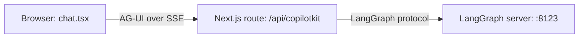

# AG-UI LangGraph Agent

> **The translator is the point.**
> `agent/` knows nothing about AG-UI. One file — `frontend/app/api/copilotkit/[[...slug]]/route.ts` —
> rewrites LangGraph's stream into AG-UI events, and the browser just watches.

A two-process agent application built to make the protocol boundary visible instead of hiding it.

- **`agent/`** — a LangGraph `StateGraph` running DeepSeek with a single `get_weather` tool.
  No AG-UI dependency of any kind.
- **`frontend/`** — a Next.js chat UI that consumes the agent as an AG-UI event stream,
  plus a side panel that logs every event as it arrives.

The interesting part is not the weather. It's the seam between the two.

---

## What it does

You send a message. The agent decides whether to call a tool, calls it, reads the result,
and answers. Every step — thinking, the tool call, the tool's output, each token of the
reply — is streamed to the browser as a typed AG-UI event, and rendered twice:

1. As a chat transcript with a live status line and tool cards.
2. As a raw event log you can read line by line.

---
## Demo 


---
## How it works



### Request lifecycle

1. **Send.** `chat.tsx` appends the user message to the agent and calls
   `copilotkit.runAgent({ agent })`, which `POST`s to `/api/copilotkit`. The request stays
   open — it becomes the event stream.
2. **Route.** The API route holds a `CopilotRuntime` with one registered agent:
   a `LangGraphAgent` pointing at `deploymentUrl` with `graphId: "sample_agent"`.
   There is no polling and no websocket.
3. **Connect.** `LangGraphAgent` opens a streaming run against the LangGraph dev server,
   using `@langchain/langgraph-sdk` with `streamMode`.
4. **Execute.** LangGraph runs the graph. The `agent` node calls DeepSeek with the message
   list; if the reply contains `tool_calls`, the conditional edge routes to the `tools`
   node, which runs `get_weather`, then loops back to `agent`.
5. **Translate.** LangGraph emits its own callback events — `on_chat_model_stream`,
   `on_tool_start`, `on_tool_end`, `values`. `@ag-ui/langgraph` converts each into an
   AG-UI event and writes it to the response as SSE.
6. **Consume.** `@ag-ui/client` in the browser parses the stream, updates
   `agent.messages`, `agent.state`, and `agent.isRunning`, and re-emits every raw event
   to subscribers.
7. **Render.** `chat.tsx` maps events to a status line; `ag-ui-panel.tsx` prints each
   event with its type, timestamp, and payload.

### Two hops, two dialects

| Segment             | Speaks                                                  |
| ------------------- | ------------------------------------------------------- |
| Browser ↔ Next.js   | **AG-UI** (`@ag-ui/client`)                             |
| Next.js ↔ LangGraph | **LangGraph's own stream** (`@langchain/langgraph-sdk`) |
| Inside `agent/`     | neither — plain LangChain                               |

The browser cannot reach LangGraph directly: LangGraph doesn't speak AG-UI, and
`deploymentUrl` is a server address. The API route is the only place both halves meet —
which is why it is also the only file in `frontend/` that imports `@ag-ui/langgraph`.

---

## Technologies

| Layer            | Technology                      | Version         | Role                                    |
| ---------------- | ------------------------------- | --------------- | --------------------------------------- |
| Agent framework  | `@langchain/langgraph`          | 1.7.5           | State machine, `StateGraph`, `ToolNode` |
| Model client     | `@langchain/deepseek`           | 1.1.25          | `ChatDeepSeek`, model `deepseek-chat`   |
| Tool schema      | `zod`                           | 4.6.7           | `get_weather` argument validation       |
| Protocol adapter | `@ag-ui/langgraph`              | 0.0.46          | LangGraph stream → AG-UI events         |
| Protocol client  | `@ag-ui/client` / `@ag-ui/core` | 1.0.5           | Event parsing, state, 31 event types    |
| Runtime bridge   | `@copilotkit/runtime`           | 1.89.0          | HTTP handler, agent registry            |
| Client bindings  | `@copilotkit/react-core`        | 1.89.0          | `useAgent`, `runAgent`                  |
| Web framework    | `next` / `react`                | 16.4.6 / 19.3.0 | API route + UI                          |
| Language         | TypeScript                      | 5.x             | Both halves                             |

Rendering is plain React plus `react-markdown`; no component library.

---

## Requirements

- **Node.js 20+** — `langgraph.json` pins `node_version: 20`
- **npm** — two independent installs, no workspace tooling
- A **DeepSeek API key** — <https://platform.deepseek.com>
- Free ports **8123** (agent) and **3000** (frontend)

No Python, no Docker, no database.

---

## Environment variables

| Variable                   | File                  | Required | Default                 | Purpose                      |
| -------------------------- | --------------------- | -------- | ----------------------- | ---------------------------- |
| `DEEPSEEK_API_KEY`         | `agent/.env`          | **yes**  | —                       | Auth for `ChatDeepSeek`      |
| `LANGGRAPH_DEPLOYMENT_URL` | `frontend/.env.local` | no       | `http://localhost:8123` | Where the agent server lives |

`agent/langgraph.json` declares `"env": ".env"`, so the LangGraph dev server loads that
file itself. `agent/.env` is gitignored.

The key never reaches the browser — it is read inside the agent process only.

---

## Running it

Two processes, two terminals.

### 1. Agent

```bash
cd agent
npm install
printf 'DEEPSEEK_API_KEY=sk-...\n' > .env
npm run dev
```

Runs `langgraphjs dev --port 8123 --no-browser`. Confirm it is up by visiting
<http://localhost:8123> — the `sample_agent` graph should be listed.

### 2. Frontend

```bash
cd frontend
npm install
npm run dev
```

Open <http://localhost:3000>.

The agent must be running first. A run attempted while the graph is offline surfaces as
`RUN_ERROR` in the events panel.

### Pointing at a remote agent

```bash
# frontend/.env.local
LANGGRAPH_DEPLOYMENT_URL=https://your-agent-host
```

---

## Project structure

```
agent/
  langgraph.json          registers the graph as "sample_agent", loads .env
  src/agent.ts            StateGraph: model node, tools node, conditional loop
  .env                    DEEPSEEK_API_KEY (gitignored)

frontend/
  app/layout.tsx                            CopilotKit provider, runtimeUrl
  app/page.tsx                              layout + events panel toggle
  app/api/copilotkit/[[...slug]]/route.ts   the protocol translator
  app/components/chat.tsx                   chat, status pill, tool cards
  app/components/ag-ui-panel.tsx            raw AG-UI event log
```

There is no root `package.json`; each directory installs independently.

---

## What you see

- **Status line** — driven by AG-UI events: `Thinking…` → `Calling get_weather…` →
  `Reading tool result…` → `Writing answer…`.
- **Tool cards** — built from the assistant message's `toolCalls`, with results matched
  back by `toolCallId`.
- **Events panel** — every event received, timestamped and colour-coded by family.
  Toggle it from the header. Streamed deltas (`TEXT_MESSAGE_CONTENT`, `TOOL_CALL_ARGS`)
  merge into one row; the list is capped at 300 entries.

---

## Event translation

`@ag-ui/langgraph` maps LangGraph's native stream onto AG-UI event types:

| LangGraph produces        | AG-UI event emitted                                                  |
| ------------------------- | -------------------------------------------------------------------- |
| run begins (`streamMode`) | `RUN_STARTED` (`threadId`, `runId`, `protocolVersion`)               |
| `on_chat_model_stream`    | `TEXT_MESSAGE_START` → `TEXT_MESSAGE_CONTENT` → `TEXT_MESSAGE_END`   |
| `on_tool_start`           | `TOOL_CALL_START` → `TOOL_CALL_ARGS` → `TOOL_CALL_END`               |
| `on_tool_end`             | `TOOL_CALL_RESULT`                                                   |
| `values` state chunk      | `STATE_SNAPSHOT` / `MESSAGES_SNAPSHOT`                               |
| `on_interrupt`            | AG-UI interrupt, resumable                                           |
| `on_custom_event`         | `ManuallyEmitMessage` / `ManuallyEmitToolCall` / `ManuallyEmitState` |
| error                     | `RUN_ERROR`                                                          |

### Event coverage

`@ag-ui/core` 1.0.5 defines **31** event types. This app handles **6**:

```
RUN_STARTED  RUN_FINISHED  RUN_ERROR
TEXT_MESSAGE_START
TOOL_CALL_START  TOOL_CALL_RESULT
```

Those six are enough for a chat transcript. The panel shows the rest if they ever fire —
including `STATE_SNAPSHOT`, `STEP_*`, `REASONING_*`, and `ACTIVITY_*` — which makes it a
usable protocol inspector, not just a log.

---

## Extending

### Add a tool

1. Define it in `agent/src/agent.ts` and append it to the `tools` array.
2. Optionally add an icon and title to the `TOOLS` map in `frontend/app/components/chat.tsx`.

No translator changes needed — `TOOL_CALL_START` carries the tool name, so the card appears
automatically. Tools without a `TOOLS` entry fall back to pretty-printed JSON.

### Swap the agent framework

Replace `agent/src/agent.ts` with anything that emits AG-UI events — CrewAI, PydanticAI, a
custom service — then drop `@ag-ui/langgraph` from the route. The frontend needs no
changes, because it only consumes the protocol.

---

## Scope

This repository is **base infrastructure**. It shows how the pieces connect, and it does
that part end to end: request, stream, translation, rendering. Everything past that point
is intentionally left to you.

### Handled here

- Two-process wiring between a LangGraph graph and a React client
- Protocol translation from LangGraph's stream to AG-UI events
- Streaming chat UI with tool cards and a live event inspector
- Tool extension without touching the translator

### Left to you

- **Security.** No authentication, authorization, session handling, CSRF protection,
  input validation, or secret rotation. `/api/copilotkit` accepts unauthenticated
  `GET`/`POST`. Securing it is entirely your responsibility.
- **Persistence.** `InMemoryAgentRunner` keeps state in process memory; a restart drops
  everything. Threads, messages, and history are not stored.
- **Multi-user and concurrency.** No tenant isolation, no per-user state, no queue.
- **Deployment.** No container, proxy, TLS, or platform configuration. Single process,
  local development only.
- **Observability and cost control.** Token usage is available in the protocol but neither
  surfaced nor enforced. No tracing, metrics, or alerting.
- **Generative UI.** A2UI packages are present in `node_modules` but nothing is wired to
  them; the agent cannot emit UI.

Treat this as a reference for the wiring, not as something to expose unchanged.

---

## Contributing

See [CONTRIBUTING.md](CONTRIBUTING.md) for setup, conventions, and what a pull request
should include.

## Features

See [FEATURES.md](FEATURES.md) for the capability list and protocol coverage.

## License

See [LICENSE](LICENSE). Free to use for personal, educational, research, and
non-commercial work. **Commercial use requires asking first** — open an issue or get in
touch, and permission is granted case by case.
